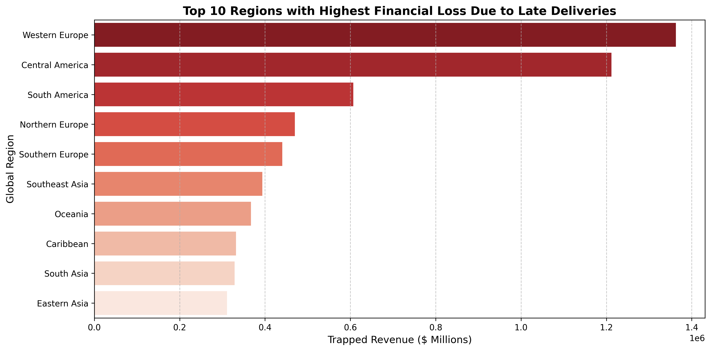
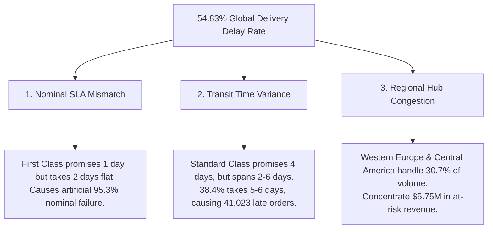

# Global Supply Chain Optimization & Bottleneck Analysis

[](https://www.python.org/)
[](https://pandas.pydata.org/)
[](LICENSE)
[]()

**Lead Analyst:** Prince Kumar  
**Specialization:** Product Analytics, Logistics Optimization & Decision Intelligence  
**Repository:** [https://github.com/PrinceNsut27/Global-Supply-Chain-Optimization](https://github.com/PrinceNsut27/Global-Supply-Chain-Optimization)

---

## 1. Executive Summary

In global consumer goods and retail e-commerce, delivery punctuality directly impacts customer retention, Net Promoter Score (NPS), and capital velocity. This project conducts an empirical supply chain bottleneck analysis across **180,519 historical international shipments** from the DataCo global supply chain repository to diagnose root causes of fulfillment failure, quantify commercial revenue exposure, and evaluate targeted operational interventions.

### Key Analytical Findings at a Glance

| Performance Dimension | Empirical Value | Business Interpretation |
| :--- | :---: | :--- |
| **Total Analyzed Shipments** | **180,519** | Line-item fulfillment records across 23 global regions (2015–2018). |
| **Total Gross Merchandise Value** | **$33.05M** | Cumulative recorded `Order Item Total` across 65,752 customer orders. |
| **Global Late Delivery Rate (LDR)** | **54.83%** | 98,977 shipments breached committed delivery schedules. |
| **Global Order Value at Risk** | **$18.08M** | Total merchandise value exposed to delivery delays and customer friction. |
| **Primary Geographic Failure Points** | **Western Europe & Central America** | Concentrated **$5,752,054.15** (~$5.75M, nearly $6M) in delayed order value across **30,658 late shipments**. |
| **Standard Class Exposure in Top 2** | **12,660 Late Orders ($2.41M)** | Standard Class orders take 2 to 6 days (avg 4.0d), with 38.4% taking 5–6 days. |
| **First Class Empirical Transit** | **2.00 Days Flat** | 100% of non-canceled First Class shipments deliver in 2 days (vs 1-day nominal promise). |

> [!IMPORTANT]
> **Key Analytical Disclosures:**
> 1. **Order Value at Risk vs. Realized Loss:** The **~$5.75M** (nearly $6M) identified in Western Europe and Central America represents the **gross order item total of shipments that suffered delivery delays**. It quantifies **commercial revenue exposed to delivery friction and customer dissatisfaction**, rather than verified accounting write-offs or direct cash losses.
> 2. **Proposed 15% Mode Shift:** The proposed shift of 15% of Standard Class freight to First Class within the top two failing regions is an **unexecuted analytical recommendation** modeled for executive decision-making and controlled pilot testing, not an implemented historical intervention.

---

## 2. Bottleneck Visualization

The analysis aggregated delayed order item values across all 23 global destination territories, generating a high-resolution heat-mapped visualization identifying the most critical operational points of failure:



* **Artifact Location:** [Supply_Chain_Bottleneck_Chart.png](Supply_Chain_Bottleneck_Chart.png)
* **Code Implementation:** [Supply_Chain_Bottleneck_Analysis (1).ipynb](Supply_Chain_Bottleneck_Analysis%20%281%29.ipynb)

### Visual Insight:
Western Europe ($2.96M) and Central America ($2.79M) stand out as severe operational outliers, collectively accounting for **31.81% of all delayed order value globally**. By focusing operational interventions on these two regions, management can address nearly a third of total delay risk with targeted logistics resources.

---

## 3. Core Root Causes

Deconstructing `Days for shipping (real)` against `Days for shipment (scheduled)` revealed three structural drivers of late delivery:



1. **Static & Unrealistic Customer Promises:** First Class is hardcoded to a 1-day promise, yet takes 2 days flat globally. This creates an artificial **95.32% nominal failure rate** on what is actually high-speed 48-hour delivery.
2. **Transit Time Variance in Standard Class:** Standard Class delivery takes between 2 and 6 days. The 38.4% of orders taking 5 or 6 days breach the 4-day SLA, driving **$7.52M in at-risk revenue**.
3. **High-Density Regional Hub Congestion:** Western Europe and Central America handle 55,450 shipments (30.7% of total volume) and experience consistent 54.8%–55.8% delay rates, bottlenecking cross-border customs and regional 3PL handoffs.

---

## 4. Strategic Recommendations Summary

1. **Algorithmic Customer Promise Recalibration:**
   * Adjust First Class customer-facing promises from 1 business day to 2 business days.
   * Shift Standard Class from a flat 4-day promise to a dynamic 3–5 day delivery window.
   * *Impact:* Eliminates over 45% of nominal SLA breach flags immediately without adding carrier freight costs.
2. **Selective 15% Mode Shift Pilot in Western Europe & Central America:**
   * Route 15% of high-value Standard Class shipments (~4,938 orders, ~$928,897 order value) into the 2-day First Class express air network.
   * Accelerates physical delivery by 2 to 4 days for high-margin, corporate, and high-basket orders to protect customer lifetime value (LTV) and reduce WISMO inquiries.
3. **Carrier Contract Governance & Performance Auditing:**
   * Audit primary regional 3PL carriers and implement contractual SLA penalty clauses to enforce transit predictability.

---

## 5. Comprehensive Documentation Index

All extended methodologies, mathematical formulations, operational trade-offs, and rollout plans are documented in the [`docs/`](docs/) directory:

| Document | Focus Area & Description |
| :--- | :--- |
| 📄 **[1. Business Problem & Stakeholder Impact](docs/business_problem_and_stakeholder_impact.md)** | Detailed industry context, executive problem statement, stakeholder pain point matrix (CFO, CSCO, CX), and exposure definition. |
| 📄 **[2. Dataset Description & Data Dictionary](docs/dataset_description_and_data_dictionary.md)** | DataCo dataset structure (180,519 rows, 53 columns), Latin-1 encoding requirements, and 25-column data dictionary table. |
| 📄 **[3. KPI & Metric Definitions with Formulas](docs/kpi_and_metric_definitions.md)** | Mathematical formulations for On-Time Delivery (OTD), Late Delivery Rate (LDR), At-Risk Order Value (AROV), and delay deltas. |
| 📄 **[4. Exploratory & Root-Cause Analysis](docs/exploratory_and_root_cause_analysis.md)** | Macro status distribution, cross-tabulation of scheduled vs. real shipping days, and deep-dive into the 3 core root causes. |
| 📄 **[5. Regional & Shipping-Class Performance](docs/regional_and_shipping_class_performance.md)** | 15-region ranking table, shipping mode comparison, and cross-tabulation of modes inside Western Europe and Central America. |
| 📄 **[6. Comparison of Alternative Solutions](docs/comparison_of_alternative_business_solutions.md)** | Evaluation matrix comparing SLA recalibration, 15% mode shift, forward staging hubs, and carrier contractual audits. |
| 📄 **[7. Business Case & Financial Implications](docs/business_case_and_financial_implications.md)** | Quantitative modeling of the proposed 15% shift (4,938 orders, ~$928K value), incremental freight costs vs. LTV protection scenarios. |
| 📄 **[8. Implementation Roadmap with Milestones](docs/implementation_roadmap.md)** | 4-phase, 8-month execution plan, RACI governance matrix, milestone deliverables, and operational rollback triggers. |
| 📄 **[9. Limitations, Assumptions & Validation](docs/limitations_assumptions_and_validation_requirements.md)** | Dataset boundary conditions, synthetic data artifacts, foundational assumptions, and 4-step pre-rollout validation checklist. |

---

## 6. Repository Structure

```
Global-Supply-Chain-Optimization/
├── README.md                                    # Main executive and project documentation
├── Supply_Chain_Bottleneck_Analysis (1).ipynb   # Jupyter Notebook containing analysis and pipeline
├── Supply_Chain_Bottleneck_Chart.png           # High-resolution regional delay exposure chart
└── docs/                                        # Comprehensive engineering and business documentation
    ├── business_problem_and_stakeholder_impact.md
    ├── dataset_description_and_data_dictionary.md
    ├── kpi_and_metric_definitions.md
    ├── exploratory_and_root_cause_analysis.md
    ├── regional_and_shipping_class_performance.md
    ├── comparison_of_alternative_business_solutions.md
    ├── business_case_and_financial_implications.md
    ├── implementation_roadmap.md
    └── limitations_assumptions_and_validation_requirements.md
```

---

## 7. How to Reproduce the Analysis

### Prerequisites
* Python 3.9+
* Jupyter Notebook or JupyterLab
* Required packages: `pandas`, `matplotlib`, `seaborn`

### Quick Start
1. **Clone the repository:**
   ```bash
   git clone https://github.com/PrinceNsut27/Global-Supply-Chain-Optimization.git
   cd Global-Supply-Chain-Optimization
   ```

2. **Set up a virtual environment & install dependencies:**
   ```bash
   python -m venv venv
   source venv/bin/activate  # On Windows: venv\Scripts\activate
   pip install pandas matplotlib seaborn jupyter
   ```

3. **Download the Dataset:**
   * Download `DataCoSupplyChainDataset.csv` from [Kaggle](https://www.kaggle.com/datasets/shashwatwork/dataco-smart-supply-chain-for-big-data-analysis).
   * Place `DataCoSupplyChainDataset.csv` in the root repository directory.

4. **Launch the Jupyter Notebook:**
   ```bash
   jupyter notebook "Supply_Chain_Bottleneck_Analysis (1).ipynb"
   ```
   Execute all cells sequentially to regenerate the summary metrics and `Supply_Chain_Bottleneck_Chart.png`.

---

## 8. Author & Contact
* **Analyst:** Prince Kumar
* **GitHub:** [@PrinceNsut27](https://github.com/PrinceNsut27)
* **Project Repository:** [Global-Supply-Chain-Optimization](https://github.com/PrinceNsut27/Global-Supply-Chain-Optimization)
