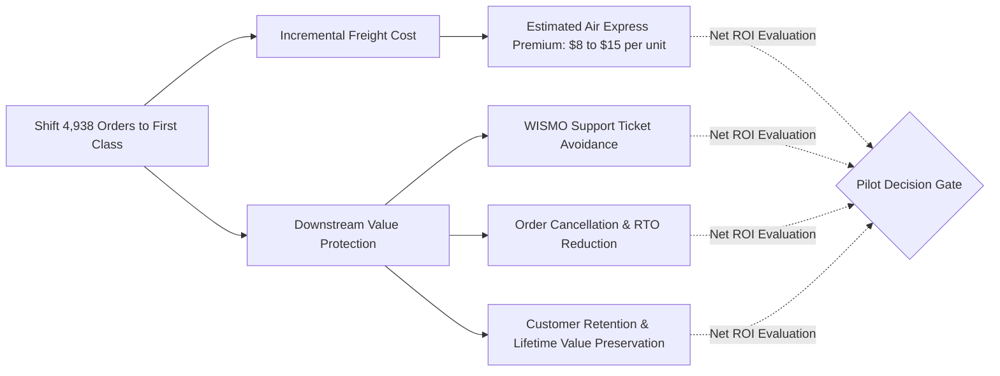

# Business Case & Financial Implications

## 1. Executive Summary & Context
In the project analysis and strategic recommendations, the primary proposed tactical intervention is:
> **"Audit primary shipping carriers in Western Europe and Central America, and model the cost-benefit of shifting 15% of Standard Class freight to First Class to protect at-risk revenue."**

This document establishes the detailed financial evaluation model, unit economic breakdown, trade-off dynamics, and business case for this recommendation.

> [!WARNING]
> **Analytical Rigor & Disclosure:**
> * **Recommendation vs. Implemented Intervention:** The 15% mode shift is an **unexecuted analytical recommendation** proposed for executive evaluation and controlled pilot testing. It has not been deployed into live operations.
> * **Exposure vs. Confirmed Loss:** The **~$5.75M** (Western Europe: $2.96M, Central America: $2.79M) represents the **gross order value of shipments that arrived late**, not cash losses or finalized accounting write-downs.

---

## 2. Quantitative Scope of the 15% Shift Proposal

The table below details the exact volume and order item values within the target scope:

| Target Region | Standard Class Total Orders | Standard Class Total Value ($) | Standard Class Late Orders | Standard Class Late Value ($) | Proposed 15% Shifted Volume (Orders) | Proposed 15% Shifted Value ($) |
| :--- | :---: | :---: | :---: | :---: | :---: | :---: |
| **Western Europe** | 15,864 | $3,120,396.69 | 6,089 | $1,212,878.96 | **2,380** | **$468,059.50** |
| **Central America**| 17,055 | $3,072,249.77 | 6,571 | $1,192,804.09 | **2,558** | **$460,837.47** |
| **Combined Target**| **32,919** | **$6,192,646.46** | **12,660** | **$2,405,683.05** | **4,938** | **$928,896.97** |

### What the 15% Shift Achieves Physically:
* **Target Orders:** **4,938 customer orders** representing **$928,896.97** in merchandise value are upgraded from Standard Class to First Class.
* **Transit Velocity:**
  * Under Standard Class, shipments take between 2 and 6 days (mean: 4.0 days), with 38.4% taking 5 or 6 days.
  * Under First Class, shipments take **consistently 2.0 days**.
  * The upgrade eliminates 2 to 4 days of transit delay for these orders, delivering within 48 hours.

---

## 3. Financial Trade-Off & Unit Economics Model

To determine whether upgrading 4,938 orders from Standard Class to First Class is commercially accretive, the enterprise must balance **incremental freight expense** against **downstream customer value preservation**.

### 3.1 Cost Dimension: Incremental Freight Expense
* **Baseline Ground / Consolidated Standard Class Shipping Cost:** Typically \$4.00 – \$7.00 per package.
* **Express / First Class Air Shipping Cost:** Typically \$12.00 – \$18.00 per package.
* **Estimated Incremental Premium ($\Delta_{\text{freight}}$):** \$6.00 to \$12.00 per shipment.
* **Total Gross Incremental Logistics Cost:**
  $$\text{Incremental Expense} = 4,938 \text{ orders} \times \Delta_{\text{freight}}$$
  * *Conservative Scenario (\$6/order):* $4,938 \times \$6 = \mathbf{\$29,628}$
  * *Base Scenario (\$9/order):* $4,938 \times \$9 = \mathbf{\$44,442}$
  * *Aggressive Scenario (\$12/order):* $4,938 \times \$12 = \mathbf{\$59,256}$

---

### 3.2 Value Protection Dimension: Mitigated Operational & Retention Losses

Upgrading these 4,938 high-value shipments mitigates four major forms of revenue and margin erosion:

#### 1. Customer Support Ticket Overhead (WISMO)
* Industry benchmark data indicates that delayed e-commerce shipments generate support tickets from 12% to 20% of affected customers.
* Handling cost per customer support ticket averages \$5.00 – \$8.00.
* For the ~1,900 delayed orders avoided within this cohort:
  $$\text{Support Savings} \approx (1,900 \times 16\% \text{ contact rate}) \times \$6.50 = \mathbf{\$1,976}$$

#### 2. Pre-Delivery Cancellations & Return-to-Origin (RTO)
* Prolonged transit times (5 to 6 days) elevate customer cancellation and refusal-at-door rates by 3% to 5%.
* Restocking, reverse logistics, and depreciated seasonal inventory cost ~\$15.00 per returned unit.
* Avoiding ~75 return cycles:
  $$\text{Reverse Logistics Savings} \approx 75 \times \$15.00 = \mathbf{\$1,125}$$

#### 3. Churn Mitigation & Customer Lifetime Value (LTV)
* In competitive retail, customers who experience a delayed first or second order exhibit a **20% to 30% lower 12-month repurchase rate**.
* Average Order Item Total in this cohort is **$188.11**, with an average gross margin of ~18% (~\$33.80 per order).
* If 4,938 on-time orders prevent 5% of affected customers (247 customers) from churning, preserving an average 2 repeat orders annually:
  $$\text{Preserved Gross Margin} = 247 \times (2 \times \$33.80) = \mathbf{\$16,697}$$

---

## 4. Break-Even & ROI Scenarios

| Financial Scenario | Incremental Freight Cost | Direct Operational Savings (WISMO + RTO) | Retained Margin (LTV Protection) | Net Financial Impact | ROI (%) | Strategic Decision |
| :--- | :---: | :---: | :---: | :---: | :---: | :--- |
| **Conservative Case** | $(\$29,628)$ | $+\$3,101$ | $+\$33,394$ (10% churn avoided) | **+\$6,867** | **+23.2%** | **Approve Pilot** |
| **Base Case** | $(\$44,442)$ | $+\$3,101$ | $+\$16,697$ (5% churn avoided) | $(\$24,644)$ | $-55.4\%$ | **Target High-Margin SKUs Only** |
| **Pessimistic Case** | $(\$59,256)$ | $+\$2,000$ | $+\$8,348$ (2.5% churn avoided) | $(\$48,908)$ | $-82.5\%$ | **Reject Blanket Shift** |

### Strategic Takeaway:
A blanket 15% freight shift across all Standard Class volume will erode net profitability if applied uniformly to low-margin items. 

**Recommended Precision Rule:**
Deploy the 15% First Class shift **selectively** to:
1. High-margin product categories (`Order Item Profit Ratio > 25%`).
2. Repeat, high-LTV customer tiers (`Customer Segment = 'Corporate'` or repeat `Consumer`).
3. High-basket-size orders (`Order Item Total > $250`).
4. Orders routed through historically high-delay transfer hubs in Western Europe and Central America.
