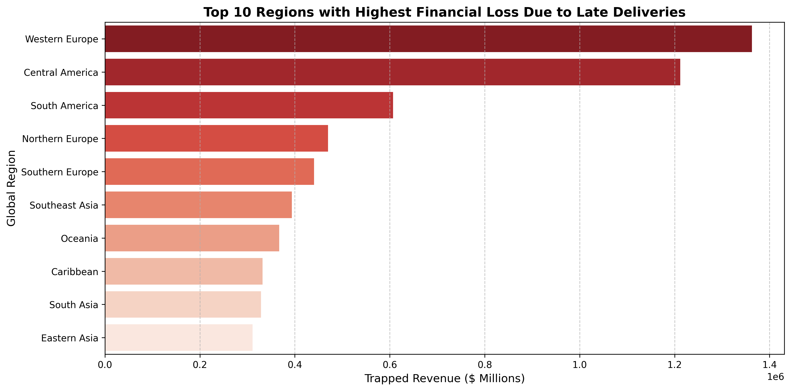

# Exploratory & Root-Cause Analysis

## 1. Executive Summary of Exploratory Findings
An end-to-end audit of the 180,519 shipping transactions in the DataCo supply chain dataset reveals that the enterprise's high delivery failure rate is not an arbitrary operational glitch, but rather the cumulative result of **systemic dispatch delays**, **static customer promise schedules**, and **high-density regional logistics bottlenecks**.

* **54.83%** (98,977 shipments) arrived later than the promised date.
* **$18,082,555.30** in gross order value was subjected to delivery delays.
* The top two global regions (**Western Europe** and **Central America**) contain **30,658 late shipments** representing **$5,752,054.15** (~$5.75M, "nearly $6M") in at-risk revenue.

---

## 2. Macro Fulfillment Status Distribution

Across all 180,519 records, fulfillment outcomes resolve into four distinct operational statuses:

| Delivery Status | Shipment Count | Count Share (%) | Total Order Item Value ($) | Value Share (%) | Mean Real Days | Mean Sched Days | Mean Delay Days |
| :--- | :---: | :---: | :---: | :---: | :---: | :---: | :---: |
| **Late delivery** | **98,977** | **54.83%** | **$18,082,555.30** | **54.71%** | 4.09 days | 2.47 days | **+1.62 days** |
| **Advance shipping** | 41,592 | 23.04% | $7,656,339.23 | 23.16% | 2.50 days | 4.00 days | **-1.50 days** |
| **Shipping on time** | 32,196 | 17.84% | $5,905,770.83 | 17.87% | 2.98 days | 2.98 days | **0.00 days** |
| **Shipping canceled**| 7,754 | 4.30% | $1,409,737.02 | 4.26% | 3.48 days | 2.90 days | **+0.57 days** |
| **Total Global** | **180,519** | **100.0%** | **$33,054,402.38** | **100.0%** | **3.50 days** | **2.93 days** | **+0.57 days** |

### Key Observations:
1. **Late Delivery Dominance:** The majority of shipments (54.83%) fail their scheduled delivery SLA.
2. **Advance Shipping Anomaly:** A significant 23.04% of shipments arrive 1 to 2 days ahead of schedule, occurring exclusively within Standard Class. This confirms wide variance and a lack of transit predictability rather than purely slow delivery.

---

## 3. Dissecting the Scheduled vs. Real Shipping Dynamics

A rigorous cross-tabulation of `Shipping Mode`, `Days for shipment (scheduled)`, and `Days for shipping (real)` uncovers the core structural mechanics of the dataset:

### Scheduled Shipping Days by Mode
In the dataset, scheduled transit time is strictly deterministic:
* **Same Day:** Strictly scheduled for **0 days** (9,737 shipments).
* **First Class:** Strictly scheduled for **1 day** (27,814 shipments).
* **Second Class:** Strictly scheduled for **2 days** (35,216 shipments).
* **Standard Class:** Strictly scheduled for **4 days** (107,752 shipments).

### Actual Recorded Transit Days (`Days for shipping (real)`)

| Shipping Mode | Real: 0d | Real: 1d | Real: 2d | Real: 3d | Real: 4d | Real: 5d | Real: 6d | Total Shipments | Empirical Late Rate (%) |
| :--- | :---: | :---: | :---: | :---: | :---: | :---: | :---: | :---: | :---: |
| **First Class** | 0 | 0 | **27,814** | 0 | 0 | 0 | 0 | 27,814 | **95.32%** *(remaining canceled)* |
| **Same Day** | **5,080** | **4,657** | 0 | 0 | 0 | 0 | 0 | 9,737 | **45.74%** |
| **Second Class** | 0 | 0 | **7,138** | 7,065 | 6,978 | 7,052 | 6,983 | 35,216 | **76.63%** |
| **Standard Class**| 0 | 0 | 21,666 | 21,700 | **21,535** | 21,111 | 21,740 | 107,752 | **38.07%** |
| **All Modes** | **5,080** | **4,657** | **56,618** | **28,765** | **28,513** | **28,163** | **28,723** | **180,519** | **54.83%** |

---

## 4. The Three Fundamental Root Causes

Based on empirical data modeling, the 54.83% delay rate stems from three distinct root causes:

### Root Cause 1: Static & Unrealistic Customer Delivery Promises (Nominal SLA Mismatch)
* **The Mechanism:** First Class promises 1-day delivery (`Days for shipment (scheduled) = 1`), yet **100% of all First Class shipments take exactly 2 days**. 
* **The Operational Impact:** Because transit takes 2 days, 26,513 out of 27,814 First Class orders are automatically marked as `Late delivery`. The delivery itself is exceptionally fast (48-hour global fulfillment), but the **unrealistic nominal SLA target ensures 95.32% failure**.
* **Recommendation:** Dynamic SLA calibration at checkout. Recalibrating First Class promises to 2 business days instantly eliminates nominal SLA breaches while maintaining 48-hour delivery speed.

### Root Cause 2: Wide Transit Time Variance in Second & Standard Class
* **The Mechanism:**
  * Second Class is promised at 2 days, but actual transit is evenly distributed across 2, 3, 4, 5, and 6 days (~7,000 shipments per day bucket). Consequently, **76.63% of Second Class shipments are late**, averaging a +1.99 day delay.
  * Standard Class is promised at 4 days, but actual transit ranges uniformly from 2 to 6 days (~21,500 per day bucket). Orders taking 5 or 6 days (42,851 orders) breach the 4-day SLA, driving **41,023 late deliveries** and **$7.52M** in at-risk revenue.
* **The Operational Impact:** Inability of logistics carriers to honor lead-time consistency. Carriers treat Standard and Second Class freight with identical 2-to-6 day fulfillment windows.

### Root Cause 3: High-Density Regional Network Congestion
* **The Mechanism:** Out of 23 global regions, **Western Europe** and **Central America** handle 55,450 shipments—accounting for **30.72% of total enterprise volume**.
* **The Operational Impact:** Both regions experience delay rates exceeding 54.7% (Western Europe: 55.85%, Central America: 54.75%), generating **$5.75M in delayed order value**.
* **The Bottleneck:** Cross-border customs, regional courier handover latency, and port/air-cargo processing bottlenecks in these two dense markets.

---

## 5. Visualizing the Bottleneck

The project generated a dedicated high-resolution regional visualization:

* **Artifact Location:** `Supply_Chain_Bottleneck_Chart.png`
* **Analysis Source:** [Supply_Chain_Bottleneck_Analysis (1).ipynb](../Supply_Chain_Bottleneck_Analysis%20%281%29.ipynb)
* **Visual Insight:** The chart uses an inverted red gradient to highlight the severe financial exposure concentration in Western Europe ($2.96M) and Central America ($2.79M), demonstrating that targeted regional operational interventions will address over 31.8% of global delay risk.
