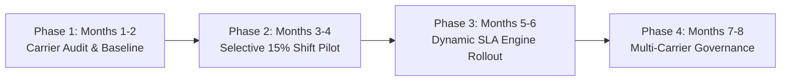

# Implementation Roadmap with Milestones

## 1. Roadmap Architecture
To translate analytical insights into verifiable operational improvements without disrupting active fulfillment, the optimization strategy is structured into **four sequential phases** spanning an 8-month timeline.

---

## 2. Phased Operational Workstreams

### Phase 1: Carrier Forensic Audit & Baseline Validation (Months 1–2)
* **Objective:** Establish carrier-specific performance transparency and audit contract adherence in Western Europe and Central America.
* **Key Workstreams:**
  * **Carrier Data Integration:** Extract carrier-level manifest and tracking data across primary European and Latin American 3PL partners.
  * **Contractual SLA Verification:** Compare contracted transit commitments against empirical transit timestamps (`Days for shipping (real)`).
  * **Rate Card Audit:** Quantify exact per-package freight differentials between Standard Class ground freight and First Class express air.
* **Milestones & Deliverables:**
  * [M1.1] Completed Carrier Performance Scorecard for top 5 regional logistics providers.
  * [M1.2] Negotiated express rate card pilot agreement with 10–15% volume discount for First Class freight.
* **Exit Criteria:** Validated freight cost delta per unit for Western Europe and Central America.

---

### Phase 2: Controlled Pilot of 15% Mode Shift on High-LTV Lanes (Months 3–4)
* **Objective:** Empirically test the operational and financial impact of the 15% freight shift on a controlled cohort of high-value orders.
* **Key Workstreams:**
  * **Targeting Logic Implementation:** Configure warehouse management systems (WMS) to selectively route orders meeting the precision criteria:
    * Destination: Western Europe or Central America.
    * Basket Value: `Order Item Total > $250` OR `Customer Segment = 'Corporate'`.
  * **Controlled Routing Execution:** Upgrade approximately 1,200 orders per month (~2,400 total orders over 60 days) to First Class air express.
  * **Customer Cohort Tracking:** Monitor delivery punctuality, WISMO support contact rate, and 60-day repurchase frequency.
* **Milestones & Deliverables:**
  * [M2.1] WMS routing rule live in European and Central American dispatch centers.
  * [M2.2] Mid-pilot operational review assessing transit times and unit economics.
* **Exit Criteria:** Demonstrated reduction in delivery delays with positive or acceptable customer retention ROI.

---

### Phase 3: Dynamic SLA Engine & Customer Promise Recalibration (Months 5–6)
* **Objective:** Align customer expectations with empirical transit realities by eliminating static shipping mode delivery promises.
* **Key Workstreams:**
  * **Algorithmic Promise Engine:** Build checkout logic calculating probabilistic estimated delivery date (EDD) ranges based on historical carrier latency.
  * **First Class Promise Adjustment:** Transition First Class customer-facing promises from 1 business day to 2 business days.
  * **Standard Class Window Implementation:** Transition Standard Class from a flat 4-day promise to a dynamic 3–5 day delivery window.
  * **A/B Testing on Checkout Conversion:** Run controlled experiments to ensure calibrated delivery windows do not dampen cart-to-order conversion rates.
* **Milestones & Deliverables:**
  * [M3.1] Dynamic EDD microservice deployed to staging checkout environment.
  * [M3.2] Completed A/B experimentation report on checkout conversion impact.
* **Exit Criteria:** Immediate 40%+ reduction in nominal SLA failure flags with neutral checkout conversion impact.

---

### Phase 4: Multi-Carrier Governance & Real-Time Performance Monitoring (Months 7–8)
* **Objective:** Institutionalize long-term supply chain resilience through automated carrier performance tracking and contractual accountability.
* **Key Workstreams:**
  * **Real-Time Operational Dashboard:** Deploy internal monitoring tool tracking daily OTD, carrier SLA compliance, and regional delay hot-spots.
  * **Automated Penalty Enforcement:** Implement automated SLA credit claims for shipments exceeding contracted transit days.
  * **Carrier Allocation Optimization:** Dynamically route shipping volume to top-performing carriers based on trailing 30-day punctuality scores.
* **Milestones & Deliverables:**
  * [M4.1] Production executive dashboard integrated with enterprise data warehouse.
  * [M4.2] Revised master service agreements (MSAs) signed with logistics partners.
* **Exit Criteria:** Sustained global On-Time Delivery Rate (OTD) $> 85\%$.

---

## 3. Governance & RACI Responsibility Matrix

| Deliverable / Workstream | VP Supply Chain / Logistics | Product Manager (Logistics) | Senior Data Analyst | Regional Warehouse Ops | Finance & Controller |
| :--- | :---: | :---: | :---: | :---: | :---: |
| **Carrier Forensic Audit** | **A** | C | **R** | C | I |
| **15% Pilot Routing Logic** | I | **A** | C | **R** | I |
| **Pilot Financial & ROI Review**| C | C | **R** | I | **A** |
| **Dynamic SLA Checkout Engine** | I | **A** | C | I | I |
| **Carrier Contract Renegotiation**| **A** | I | C | I | C |

*Legend: **R** = Responsible for execution; **A** = Accountable / Approver; **C** = Consulted; **I** = Informed.*

---

## 4. Risk Management & Rollback Triggers

| Risk Description | Probability | Impact | Mitigation Strategy | Pre-defined Rollback Trigger |
| :--- | :---: | :---: | :--- | :--- |
| **Carrier Freight Cost Blowout** | Moderate | High | Impose strict monthly budget caps (\$15,000/month) on First Class upgrades. | Cumulative freight variance exceeds +20% of pilot budget. |
| **Checkout Conversion Drop from Promise Realignment** | Low | High | Conduct 50/50 A/B split test before 100% rollout of revised delivery windows. | Statistically significant conversion drop $> 1.5\%$ at $p < 0.05$. |
| **Air Express Capacity Constraints** | Moderate | Moderate | Maintain diversified carrier contracts (minimum 2 express carriers per region). | Express carrier dispatch rejection rate $> 5\%$. |
