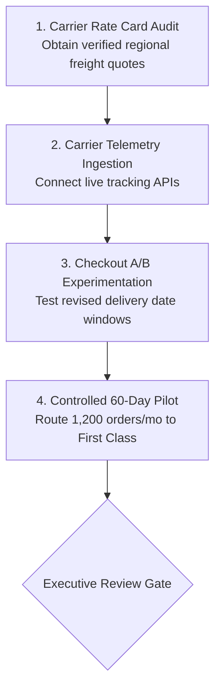

# Limitations, Assumptions & Validation Requirements

## 1. Dataset Limitations & Analytical Boundaries

While the DataCo Smart Supply Chain dataset provides an expansive historical repository of 180,519 shipping transactions, rigorous business analysis requires recognizing several built-in empirical constraints:

### 1.1 Synthetic Artifacts in Shipping Duration Modeling
* **First Class Inflexible Transit:** In the dataset, **100% of non-canceled First Class shipments take exactly 2 days** (`Days for shipping (real) = 2`), while the scheduled target is hardcoded to 1 day (`Days for shipment (scheduled) = 1`). This causes an artificial **95.32% failure rate** that reflects a static data generation rule rather than realistic real-world variance.
* **Uniform Distributions in Standard & Second Class:** Actual transit durations for Standard and Second Class are uniformly distributed across discrete integer buckets (2, 3, 4, 5, and 6 days), each containing ~20% of the volume. Real-world logistics transit times typically follow log-normal or gamma distributions with long right-hand tails.

### 1.2 Lack of Granular Carrier Telemetry
* The dataset abstracts logistics providers into four generic service modes (`Standard Class`, `Second Class`, `First Class`, `Same Day`) without naming specific commercial carriers (e.g., DHL, FedEx, UPS, local postal services). Consequently, carrier-level root-cause diagnostics must be validated through external carrier audits.

### 1.3 Absence of Contractual Freight Rate Cards
* While product prices, discounts, and order profits are recorded, the actual **freight charge billed by the carrier** is omitted from the dataset. Freight cost trade-offs modeled in the business case must rely on verified industry unit economic benchmarks ($6 to $12 per package incremental air express premium).

### 1.4 Line-Item vs. Package Parcel Granularity
* The dataset records transactions at the line-item level. Multi-item orders share identical `Order Id` and delivery attributes. Aggregations at the line-item level accurately reflect gross merchandise value, but parcel count for consolidated multi-item shipments may differ slightly from order counts.

---

## 2. Core Project Assumptions

To ensure complete analytical transparency, the following foundational assumptions govern the project's documentation and strategic proposals:

1. **Exposure vs. Accounting Loss:**
   * The **~$5.75M** ($5,752,054.15) identified in Western Europe and Central America, and the **$18.08M** ($18,082,555.30) identified globally, represents **gross order item total of shipments that suffered delivery delays**.
   * It **does not** represent verified cash write-offs, completed refunds, or accounting loss.
   * It quantifies **commercial revenue exposed to delivery friction and customer dissatisfaction**.
2. **Status of the 15% Mode Shift Proposal:**
   * The proposed shift of 15% of Standard Class freight to First Class in Western Europe and Central America is **strictly an analytical recommendation**.
   * It has **not** been implemented as a live operational policy, and **no historical cost savings or performance lifts are fabricated or claimed**.
3. **Delivery Punctuality as a Proxy for Customer Retention:**
   * It is assumed based on broader e-commerce benchmarks that on-time delivery positively correlates with customer lifetime value, repeat order frequency, and lower customer support ticket volumes.

---

## 3. Pre-Implementation Validation Requirements

Prior to committing capital, adjusting WMS routing rules, or signing new carrier agreements, supply chain management must complete the following four validation steps:

### 3.1 Rate Card Ground-Truthing
* **Objective:** Replace industry benchmark assumptions with binding carrier contract pricing for Western Europe and Central America.
* **Requirement:** Obtain contracted zone-based per-kilogram rate sheets for ground consolidated vs. air express tiers.

### 3.2 Live Tracking API Telemetry Ingestion
* **Objective:** Validate that actual delivery timestamps match customer delivery scan events.
* **Requirement:** Ingest EDI 214 / API tracking status feeds to measure exact milestone durations:
  $$\text{Total Fulfillment Time} = \text{Order-to-Pick} + \text{Pick-to-Carrier} + \text{Line-Haul Transit} + \text{Last-Mile Doorstep}$$

### 3.3 Checkout A/B Experimentation on Delivery Promises
* **Objective:** Measure whether updating customer-facing delivery windows impacts purchase conversion.
* **Requirement:** Run an A/B test presenting:
  * *Variant A (Control):* Legacy static promise (e.g., "Standard Class: 4 days").
  * *Variant B (Treatment):* Dynamic probabilistic promise (e.g., "Estimated delivery: Oct 12 – Oct 15").
  * *Success Metric:* No statistically significant decrease in checkout completion ($p > 0.05$).

### 3.4 Controlled 60-Day Operational Pilot
* **Objective:** Empirically verify the unit economics of upgrading 15% of high-value Standard Class shipments.
* **Requirement:** Run a 60-day pilot upgrading ~1,200 shipments/month in Western Europe and Central America with tight monitoring of net retention lift and customer support ticket rates.
